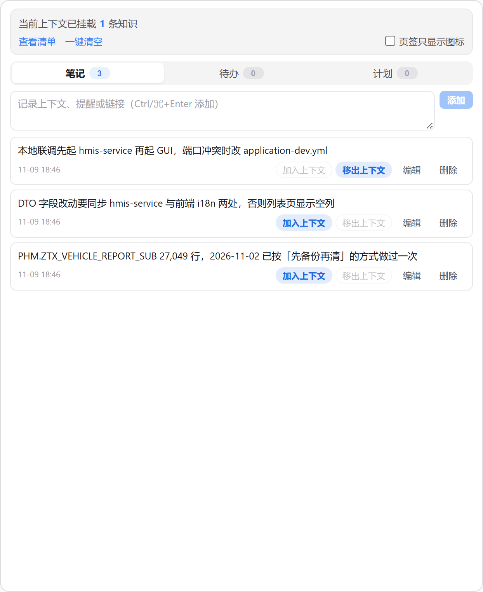
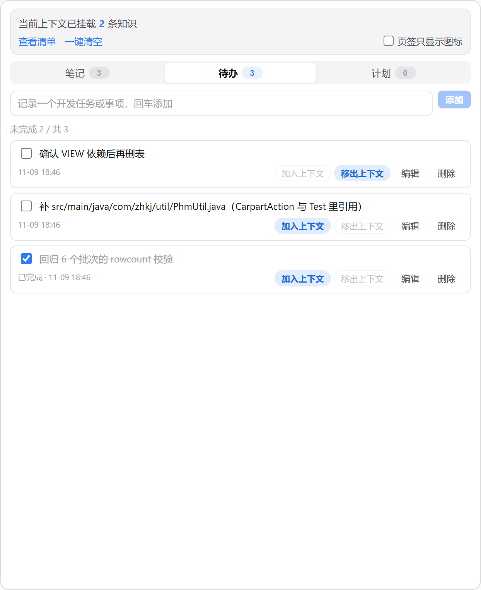
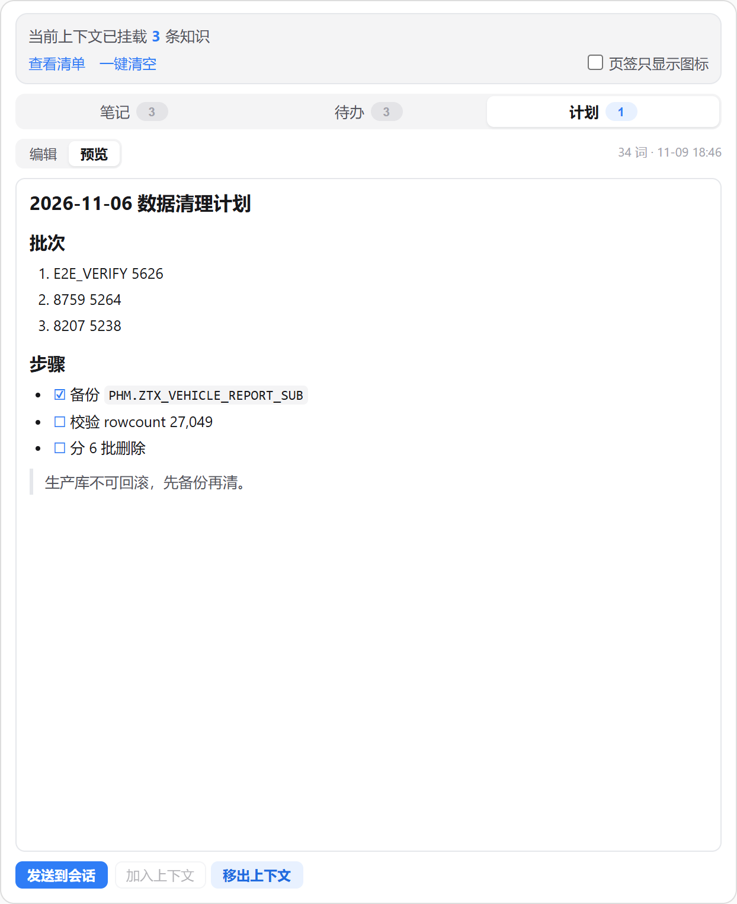
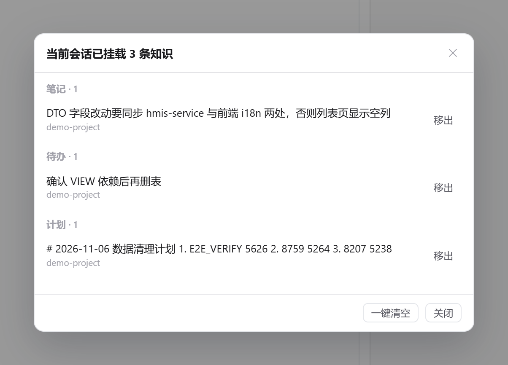

# 项目知识（project-knowledge）

把当前项目的 **笔记 / 待办 / 计划** 挂载进对话上下文：右侧面板三 Tab 增删改，挂载按会话隔离，
发送前自动注入给模型，移出后下一轮即不再携带。



## 功能

| 位置 | 内容 |
|---|---|
| 顶部状态栏 | 「当前上下文已挂载 N 条知识」+「查看清单」+「一键清空」（二次确认）+「页签只显示图标」开关 |
| 右侧页签 | 与内置「文件」「变更」同一排：图标 + **知识**（默认）；勾上开关后只留图标 |
| 笔记 Tab | 新增 / 编辑 / 删除；每条一对【加入上下文】【移出上下文】 |
| 待办 Tab | 复选框切换完成态；新增 / 编辑 / 删除；每条一对【加入上下文】【移出上下文】 |
| 计划 Tab | Markdown 编辑器 + 编辑/预览切换；【发送到会话】【加入上下文】【移出上下文】 |
| 输入框状态条 | 「项目知识 N」胶囊，点开即看挂载清单，可单条移出或一键清空 |

「加入上下文」与「移出上下文」成对出现：当前状态那一个高亮，另一个置灰，不会误判。

### 页签的两种长相

插件页签本身只接受一个图标组件（宿主只往里面塞 `className` / `aria-hidden`），
所以「知识」这两个字是插件自己画的，好处是能跟你一起做选择：

| 模式 | 长这样 | 什么时候用 |
|---|---|---|
| 图标 + 文字（默认） | `▤ 知识` | 和内置「文件」「变更」并排，一眼看得懂这是干嘛的 |
| 仅图标 | `▤` | 右侧页签条太挤，或你已经认得这枚图标；悬停仍有「项目知识」提示 |

开关在面板顶部的「页签只显示图标」复选框，选中即生效（页签条不用刷新），
写进插件自己的 KV，下次打开 GUI 还是这个状态。关掉文字不影响面板里的任何功能。







## 业务规则

- **笔记**：纯文本，无状态，可挂载 / 卸载。
- **待办**：复选框切换完成态（注入时体现为 `- [x]` / `- [ ]`），可挂载 / 卸载。
- **计划**：Markdown，可挂载 / 卸载；【发送到会话】把当前 Markdown 作为一条消息发进对话。
- **公共约束**：挂载后模型发送时自动读取；移出后不再带入；【查看清单】汇总当前挂载。
- **删除即失效**：条目被删除时，所有会话里指向它的挂载记录一并清掉。

## 会话隔离

挂载按 **引擎 + 会话 id** 分桶：

- 有会话 id → `s:<engine>/<sessionId>`；
- 新建中（会话 id 为空）→ `p:<engine>@<工作区>`，会话一建立立刻并入 `s:` 桶，首轮挂载不丢；
- 不同会话互不可见，切换会话时顶部计数与清单随之切换。

工作区路径做了归一化（反斜杠 / 尾斜杠 / 盘符大小写），且**不会跨工作区猜测**：
同一引擎在不同工作区各挂一个「尚未建立」的会话时，两边的待迁移挂载互不串味。

## 实现要点

- 注入走 `ctx.hooks.registerTurnHooks({ beforeTurn })`，产出单条 `promptContribution`
  （`placement: request-tail`、`visibility: internal`、`persistence: turn`），宿主把它附在本轮 prompt 之后。
  这是宿主唯一能让「挂载态」随每一轮重建的通道——移出即不带，不需要重启会话。
- 宿主对所有插件的提示贡献合计只有 12KB 预算，本插件自留 8KB，超出部分省略并在上下文里注明。
- 页签条里的插件 tab 只渲染图标组件（`label` 只作 hover 提示与无障碍名）。`registerPanelTab` 显式注册了
  与宿主「文件」「变更」同规格的 lucide 描边图标（24×24 viewBox、`stroke-width: 2`、
  `currentColor`、圆头圆角），选中 / 未选中都跟随宿主的主题色，不会回落成彩色首字母瓷砖。
- 「知识」两个字由图标组件自己画（宿主只往组件里塞 `className` / `aria-hidden`，不渲染插件文字），
  字体取宿主同一档 `text-body-2-medium` 的数值并跟随 `--ui-font-scale` / `--ui-font-weight-offset`，
  所以和内置页签的字号、行高、字重完全对齐。开关状态存在同一个 KV 的 `ui.showLabel`
  （`false` 才是仅图标，缺省/老数据一律显示文字），组件订阅 store，勾选后页签当场重渲染。
- 存储走 `ctx.storage` 单键 `knowledge:v1`（宿主 `plugin_kv`），按工作区分片存笔记 / 待办 / 计划，
  `mounts` 单独存挂载。不读写 `localStorage`，不碰宿主内部对象。
- 计划【发送到会话】用 `ctx.sessions.startRun`：宿主没有「往当前会话追加一条消息」的插件 API。
  宿主暴露 `supportsResume` 且当前有会话时带上 sessionId 续接当前对话；否则开新会话并在提示里**如实说明**。
  两者都不行（旧宿主 / 无活动会话）时退化为写入输入框，绝不静默失败。

## 权限

| 权限 | 用途 |
|---|---|
| `ui:panel-tab` | 右侧面板「项目知识」页签 |
| `ui:composer-status` | 输入框状态行的「项目知识 N」胶囊 |
| `storage` | 笔记 / 待办 / 计划 / 挂载记录落宿主插件 KV |
| `events` | 订阅 `session://activated`，跟随当前会话切换挂载视图 |
| `prompt.contribute.internal` | `beforeTurn` 注入挂载内容 |
| `host:session` | 计划【发送到会话】经 `ctx.sessions.startRun` 发消息、打开会话 |
| `composer:draft` | 发送失败时把计划写入输入框作为兜底 |

无网络、无进程执行、无文件系统访问。

## 数据去哪

全部数据只存在本机宿主插件私有 KV（`ctx.storage`，宿主 `app.db` 的 `plugin_kv` 表），
键名 `knowledge:v1`。不联网、不上传、不写入工作区目录。卸载插件时按宿主的插件数据保留策略处理。

## 安装

1. CC GUI 侧栏「插件」→「从本地目录安装」→ 选本目录（含 `manifest.json` 的那一层）。
2. 权限清单里放行上表七项。
3. 右侧面板出现「项目知识」页签；输入框状态行出现「项目知识 N」胶囊。

## 已知限制

- 计划【发送到会话】在宿主不支持 resume 时会新建会话（协议所限，非降级实现）。
- 无活动会话（没打开任何标签页）时条目仍可编辑，但【加入上下文】置灰：挂载必须有归属会话。
- 存储是单用户低并发的 KV，多窗口同时编辑以最后写入为准。

## 开发与自测

核心逻辑抽在 `main.js` 里，用最小化宿主桩跑 `node:test`（不依赖宿主、不联网）：

```bash
node --test test/core.test.mjs
```

覆盖：未挂载不注入、只注入已挂载、会话隔离、pending → 会话迁移、工作区路径写法差异、
跨工作区不串味、删除条目后不再注入、超长内容按预算截断。

## 发版

`manifest.json` 的 `version` +1，打同名 tag（无 `v` 前缀）推送，
`.github/workflows/release.yml` 会校验 manifest、算 SHA-256 并把 `main.js` / `manifest.json` /
`styles.css` / `checksums.txt` 附到该 tag 的 Release。

```bash
git tag 0.1.2 && git push origin 0.1.2
```

## 许可

MIT
